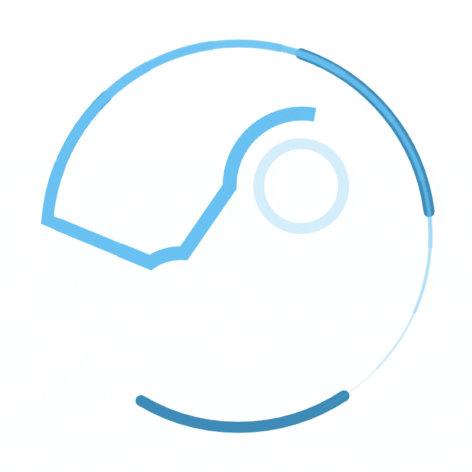

<a name="readme-top"></a>

[![Contributors][contributors-shield]][contributors-url]
[![Forks][forks-shield]][forks-url]
[![Stargazers][stars-shield]][stars-url]
[![Issues][issues-shield]][issues-url]
[![Last Commit][last-commit-shield]][commit-url]
[![LinkedIn][linkedin-shield]][linkedin-url]

<!-- PROJECT LOGO -->
<br />
<div align="center">
  <a href="https://github.com/Sia-WRWD/my-portfolio-v2">
    
  </a>

<h3 align="center">My Personal Portfolio Website</h3>

  <p align="center">
    A Steam-profile-inspired portfolio built with Angular 22 and hosted on Netlify.
    <br />
    <a href="https://github.com/Sia-WRWD/my-portfolio-v2/blob/main/README.md"><strong>Explore the docs »</strong></a>
    <br />
    <br />
    <a href="https://www.heysia.dev">View Demo</a>
    ·
    <a href="https://github.com/Sia-WRWD/my-portfolio-v2/issues/new?labels=bug&template=bug-report---.md">Report Bug</a>
    ·
    <a href="https://github.com/Sia-WRWD/my-portfolio-v2/issues/new?labels=enhancement&template=feature-request---.md">Request Feature</a>
  </p>
</div>

<!-- TABLE OF CONTENTS -->
<details>
  <summary>Table of Contents</summary>
  <ol>
    <li>
      <a href="#about-the-project">About The Project</a>
      <ul>
        <li><a href="#features">Features</a></li>
        <li><a href="#built-with">Built With</a></li>
      </ul>
    </li>
    <li>
      <a href="#getting-started">Getting Started</a>
      <ul>
        <li><a href="#prerequisites">Prerequisites</a></li>
        <li><a href="#installation">Installation</a></li>
        <li><a href="#environment-variables">Environment Variables</a></li>
        <li><a href="#scripts">Scripts</a></li>
      </ul>
    </li>
    <li><a href="#project-structure">Project Structure</a></li>
    <li><a href="#updating-content">Updating Content</a></li>
    <li><a href="#resources-used">Resources Used</a></li>
    <li><a href="#acknowledgments">Acknowledgments</a></li>
  </ol>
</details>

<!-- ABOUT THE PROJECT -->
## About The Project

[![Product Name Screen Shot][product-screenshot]](https://www.heysia.dev)

Welcome to the source of my personal portfolio website. This website contains all you need to know about myself, past education, experiences and projects. The UI of the website was inspired by the popular gaming platform, Steam's Profile Page.

<p align="right">(<a href="#readme-top">back to top</a>)</p>

### Features

* **Steam-style profile** – level ring, socials, "Currently In-Game" status, achievements, groups, games and friends (with hover mini-profiles), all laid out like a Steam community profile.
* **Showcase sections**
  * **Stacks** – filterable tech-stack icons.
  * **Work-Exp** – each role shown as a game in "Recent Activity", with playtime ("x yrs on record") calculated from its dates.
  * **Projects** – store-style capsules with a featured project, tech tags and tilt-on-hover.
  * **Education** – achievement-style milestones with a step-through scroller.
* **Profile themes** – switch between Seasonal (default, follows the current season), Summer, Midnight, Steel and Cosmic from the palette widget.
* **Intro sequence** – a "Click to Start!" boot-up video with a **Skip Intro** button. Every section's entrance animation waits for the intro to finish, then plays on scroll.
* **Contact form** – EmailJS-powered modal with an embedded map. It closes with <kbd>Esc</kbd> or by clicking outside.
* **Playful 404 page** – a Steam-style "profile could not be found" page for unknown routes.
* **Accessibility** – honours `prefers-reduced-motion` by skipping or simplifying animations.

<p align="right">(<a href="#readme-top">back to top</a>)</p>

### Built With

* [![Angular][Angular.js]][Angular-url]
* [![TypeScript][TypeScript]][TypeScript-url]
* [![SASS][SASS]][SASS-url]
* [![FontAwesome][FontAwesome]][FontAwesome-url]
* [![NG-ZORRO][NG-ZORRO]][NG-ZORRO-url] (carousel, modal, tooltip)
* [anime.js](https://animejs.com/) – entrance and scroll animations
* [Vanilla Tilt](https://micku7zu.github.io/vanilla-tilt.js/) – hover tilt effects
* [EmailJS](https://www.emailjs.com/) – contact form emails
* [Sakana Widget](https://github.com/dsrkafuu/sakana-widget) – the bouncing Takina widget

<p align="right">(<a href="#readme-top">back to top</a>)</p>

<!-- GETTING STARTED -->
## Getting Started

### Prerequisites

* **Node.js** `^22.22.3`, `^24.15.0` or `^26.0.0` (see `engines` in `package.json`). The Angular CLI exits with code 3 on anything older. Netlify is pinned to `22.22.3` in `.node-version`; a `NODE_VERSION` set in the Netlify UI overrides that file, so it must be `22.22.3` or newer too.
* **npm** (bundled with Node.js)

### Installation

1. Clone the repo
   ```sh
   git clone https://github.com/Sia-WRWD/my-portfolio-v2.git
   cd my-portfolio-v2
   ```
2. Install dependencies
   ```sh
   npm install
   ```
3. Start the dev server and open `http://localhost:4200/`
   ```sh
   npm start
   ```

### Environment Variables

The contact form sends mail through EmailJS and reads its keys from `process.env` at build time. Set them in Netlify (**Site settings → Environment variables**) or in your local shell:

| Variable | Description |
| --- | --- |
| `EMAIL_SERVICE_ID` | EmailJS service ID |
| `EMAIL_TEMPLATE_ID` | EmailJS template ID |
| `EMAIL_USER_ID` | EmailJS public key |

The rest of the site works without them; only sending the contact form needs them.

### Scripts

| Command | Description |
| --- | --- |
| `npm start` | Runs `ng serve` with live reload |
| `npm run build` | Production build into `dist/` |
| `npm run watch` | Development build in watch mode |
| `npm test` | Runs the Karma/Jasmine unit tests |

<p align="right">(<a href="#readme-top">back to top</a>)</p>

<!-- PROJECT STRUCTURE -->
## Project Structure

```text
src/
├── app/
│   ├── dashboard/                  # The profile page
│   │   ├── loader/                 # Intro video + Skip Intro
│   │   ├── navigation/             # Top nav and mobile menu
│   │   ├── profile-header/         # Avatar, level ring, socials
│   │   ├── profile-content/        # Showcases (stacks, work-exp, projects, education),
│   │   │                           # contact form and right-hand sidebar
│   │   ├── footer/
│   │   └── shared/
│   │       ├── data/               # All site content (see "Updating Content")
│   │       ├── directives/         # Scroll-reveal, scroll-spy, tooltip, etc.
│   │       └── service/            # Intro, theme, modal, season and scroll services
│   └── not-found/                  # 404 page
├── assets/                         # Icons, images and RESUME.pdf
└── styles/                         # Shared Sass mixins
```

<p align="right">(<a href="#readme-top">back to top</a>)</p>

<!-- UPDATING CONTENT -->
## Updating Content

Most content is plain data in `src/app/dashboard/shared/data/`, so updating the site rarely needs template changes:

| File | Content |
| --- | --- |
| `work-exp.ts` | Work experience. Use dates like `'Jan 2024'` or `'April 2026'`, and `'Now'` for a current role |
| `project.ts` | Projects and their tech tags |
| `edu.ts` | Education milestones |
| `stack-data.ts` | Tech stack icons and filter categories |
| `right-content.ts` | Achievements, groups, games and friends in the sidebar |
| `activity.ts` | The "Currently …" status shown for each time of day |
| `background.ts` / `profile-pic.ts` | Seasonal backgrounds and profile pictures |

The downloadable résumé lives at `src/assets/RESUME.pdf`.

<p align="right">(<a href="#readme-top">back to top</a>)</p>

<!-- RESOURCES -->
## Resources Used
1. [On-Scroll Reveal Animation with React & Framer Motion](https://youtu.be/2V1WK-3HQNk?si=GUd_iBUAG38Gvc0C)
2. [Mouse Hover Tilt using Vanilla Tilt JS](https://micku7zu.github.io/vanilla-tilt.js/)
3. [Sending Emails from React App with EmailJS | Step-by-Step Tutorial](https://youtu.be/wWiTouBHibs?si=5hgHlVj2ghBfUnB_)
4. [Setup a Custom Domain in Netlify in 5 Minutes](https://www.youtube.com/watch?v=bY7Tkh9Vz8I)
5. [Make React Audio Player with Controls & Waveform](https://www.youtube.com/watch?v=rT6GiYEIdGs)

#### Angular Components
1. [NZ-Carousel](https://ng.ant.design/components/carousel/en)
2. [NZ-Modal](https://ng.ant.design/components/modal/en)
3. [GlassMorphism](https://css.glass/)
4. [Scroll-Into-View](https://stackoverflow.com/questions/49820013/javascript-scrollintoview-smooth-scroll-and-offset)
5. [Google Map Contact](https://www.youtube.com/watch?v=nwEB3Wxh5N0&t=955s&ab_channel=CarpoolVenom)
6. [Tooltip-Directive](https://www.youtube.com/watch?v=5-gssFQ7ILk&ab_channel=LEARNINGPARTNER)
7. [Intersection Observer API](https://developer.mozilla.org/en-US/docs/Web/API/Intersection_Observer_API) (scroll-reveal directive)

#### Misc Resources
1. [Mobile Responsive Hamburger Icon](https://codepen.io/alvarotrigo/pen/ExwgbZv)
2. [Profile Background](https://steamcommunity.com/id/jcn_loveinapril)
3. [Profile Picture Frame](https://steamcommunity.com/id/jcn_loveinapril)
4. [Vector Logo](https://worldvectorlogo.com/logo/azure-2)
5. [GitHub Shields Logo](https://github.com/Ileriayo/markdown-badges)
6. [CSS Animations](https://codepen.io/nelledejones/pen/gOOPWrK)
7. [Scroll-to-Top During Refresh](https://stackoverflow.com/questions/3664381/force-page-scroll-position-to-top-at-page-refresh-in-html)
8. [To Debug Tooltip](https://stackoverflow.com/questions/15370838/inspect-hovered-element-in-chrome)
9. [Picture to SVG Line Art](https://tech-lagoon.com/imagechef/en/image-to-edge.html)
10. [Backdrop-Filter Causes Lag](https://stackoverflow.com/questions/62140523/why-does-a-blur-filter-with-a-transition-have-some-lag-and-problem)

#### Note for Self on SVG Icon Creation & Netlify Prod Env
1. Look for existing SVG (WorldVectorLogo, Github Shields). Prefer saving icons into `src/assets/icons/stacks/` over hot-linking, since external CDN links can break.
2. To enable icon color change based on the css property of color, change the fill in svg path to "currentColor".
3. For Netlify Prod Env, make sure that the types: ["node"] is added to tsconfig.app.json instead.

<p align="right">(<a href="#readme-top">back to top</a>)</p>

<!-- ACKNOWLEDGMENTS -->
## Acknowledgments

This markdown was created with the help of the template provided by user othneildrew:

* [Best-README-Template](https://github.com/othneildrew/Best-README-Template)

<p align="right">(<a href="#readme-top">back to top</a>)</p>

<!-- MARKDOWN LINKS & IMAGES -->
<!-- https://www.markdownguide.org/basic-syntax/#reference-style-links -->
[contributors-shield]: https://img.shields.io/github/contributors/Sia-WRWD/my-portfolio-v2.svg?style=for-the-badge
[contributors-url]: https://github.com/Sia-WRWD/my-portfolio-v2/graphs/contributors
[forks-shield]: https://img.shields.io/github/forks/Sia-WRWD/my-portfolio-v2.svg?style=for-the-badge
[forks-url]: https://github.com/Sia-WRWD/my-portfolio-v2/network/members
[stars-shield]: https://img.shields.io/github/stars/Sia-WRWD/my-portfolio-v2.svg?style=for-the-badge
[stars-url]: https://github.com/Sia-WRWD/my-portfolio-v2/stargazers
[issues-shield]: https://img.shields.io/github/issues/Sia-WRWD/my-portfolio-v2.svg?style=for-the-badge
[issues-url]: https://github.com/Sia-WRWD/my-portfolio-v2/issues
[last-commit-shield]: https://img.shields.io/github/last-commit/Sia-WRWD/my-portfolio-v2.svg?style=for-the-badge
[commit-url]: https://github.com/Sia-WRWD/my-portfolio-v2/commits/main/
[linkedin-shield]: https://img.shields.io/badge/-LinkedIn-black.svg?style=for-the-badge&logo=linkedin&colorB=555
[linkedin-url]: https://www.linkedin.com/in/Sia-WRWD/
[product-screenshot]: /public/githubthumb.jpg
[Angular.js]: https://img.shields.io/badge/Angular-20232A?style=for-the-badge&logo=angular&logoColor=DD0031
[Angular-url]: https://angular.dev/
[TypeScript]: https://img.shields.io/badge/TypeScript-20232A?style=for-the-badge&logo=typescript&logoColor=3178C6
[TypeScript-url]: https://www.typescriptlang.org/
[SASS]: https://img.shields.io/badge/SASS-20232A?style=for-the-badge&logo=sass
[SASS-url]: https://sass-lang.com/
[FontAwesome]: https://img.shields.io/badge/Fontawesome-20232A?style=for-the-badge&logo=fontawesome
[FontAwesome-url]: https://github.com/FortAwesome/angular-fontawesome
[NG-ZORRO]: https://img.shields.io/badge/NG--ZORRO-20232A?style=for-the-badge&logo=antdesign&logoColor=1890FF
[NG-ZORRO-url]: https://ng.ant.design/
